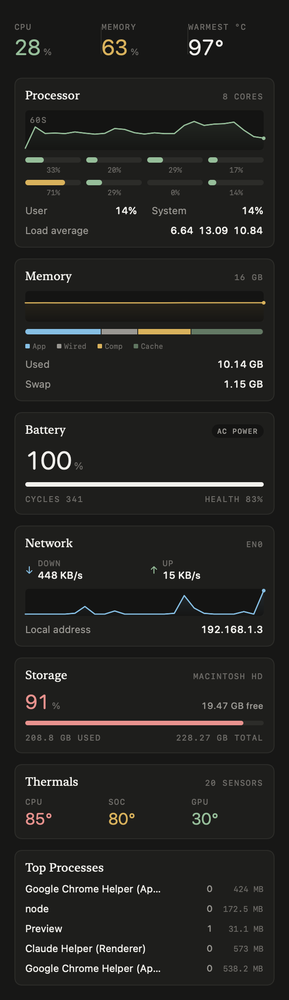
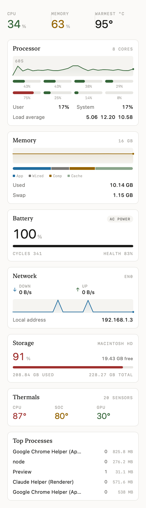
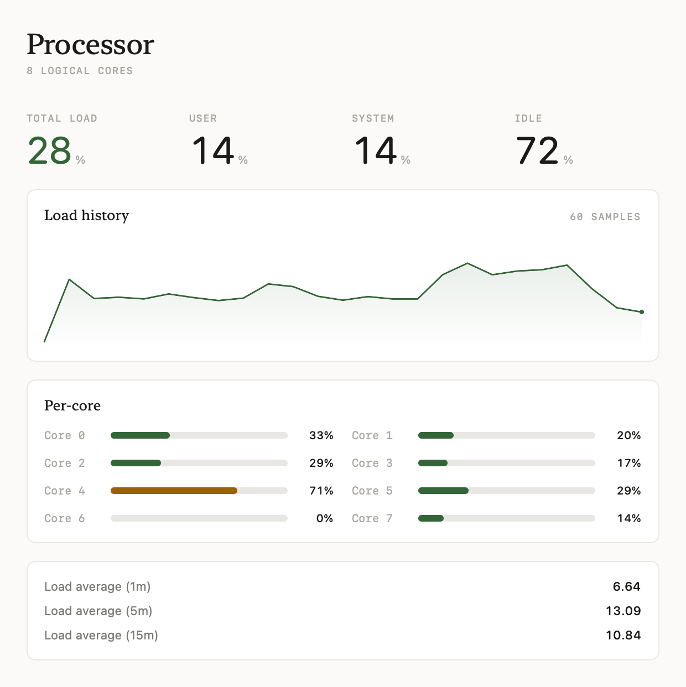
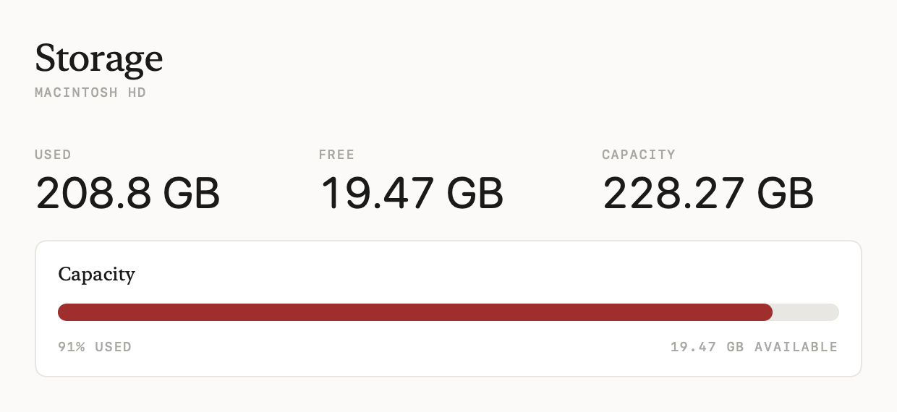

# MacPulse

A macOS menu bar system monitor. Native SwiftUI, no third-party dependencies,
no Xcode required to build.

[](https://github.com/Anrahya/MacPulse/actions/workflows/ci.yml)
[](LICENSE)
[](#requirements)
[](Package.swift)

MacPulse watches CPU, memory, battery, network, storage, processes, and thermal
sensors, and surfaces them in a compact popover plus a full dashboard window.

| Dark | Light |
| --- | --- |
|  |  |





## Contents

- [Highlights](#highlights)
- [Requirements](#requirements)
- [Build and run](#build-and-run)
- [Usage](#usage)
- [What it measures](#what-it-measures)
- [Architecture](#architecture)
- [Notes on macOS APIs](#notes-on-macos-apis)
- [Testing](#testing)
- [Contributing](#contributing)
- [License](#license)

## Highlights

- **Seven modules** in one lightweight menu bar item
- **Temperatures without root**, on Apple Silicon included
- **No dependencies** — pure SwiftUI, AppKit, IOKit and libproc
- **Light and dark** appearance, with a restrained warm-monochrome design
- **Cheap at idle** — roughly 0% CPU and ~85 MB resident

## Requirements

- macOS 14 Sonoma or later
- Swift 5.9 or later

Building works with either a full Xcode install or just the Command Line Tools:

```bash
xcode-select --install
```

The Command Line Tools are enough to compile and run the app. Running the test
suite is the one thing that currently needs full Xcode, because XCTest is not
bundled with the Command Line Tools.

## Build and run

```bash
git clone https://github.com/Anrahya/MacPulse.git
cd MacPulse
./scripts/build-app.sh
open build/MacPulse.app
```

`scripts/build-app.sh` compiles with Swift Package Manager and assembles a
signed (ad hoc) `.app` bundle in `build/`. Pass `debug` for a faster, larger
build:

```bash
./scripts/build-app.sh debug
```

To compile without bundling:

```bash
swift build -c release
```

MacPulse is a menu bar app (`LSUIElement`), so it has no Dock icon. Look for the
pulse glyph in the menu bar after launching.

## Usage

Click the menu bar item to open the popover. It shows headline CPU, memory and
temperature figures, then a card per module.

- **Dashboard button** (bottom left of the popover) opens a full window with a
  dedicated pane for each module and more detail per metric
- **Sampling interval** defaults to 2 seconds and is configurable from 1 to 10
- **Menu bar display** can show CPU load, memory used, hottest sensor, battery
  level, or the icon alone
- **Quit** with the power button in the popover footer

Preferences live in the standard Settings window.

## What it measures

| Module | Source | Notes |
| --- | --- | --- |
| CPU | `host_processor_info` | Per-core deltas, user/system split, load averages |
| Memory | `host_statistics64`, `vm.swapusage` | App, wired, compressed and cached pages |
| Battery | `AppleSmartBattery` IORegistry | Charge, health, cycles, voltage, draw |
| Network | `sysctl NET_RT_IFLIST2` | Throughput per interface from byte counters |
| Storage | `attributesOfFileSystem` | Boot volume capacity and free space |
| Processes | `proc_listpids`, `proc_pid_rusage` | CPU time deltas and resident memory |
| Temperatures | IOKit HID sensor registry | 20+ named die sensors, no root needed |

Fast metrics (CPU, memory, network) refresh on the configured interval. Slow
metrics (battery, storage, processes, temperatures) refresh at twice that
interval to keep the app light.

## Architecture

```
Sources/MacPulse/
├── MacPulseApp.swift        MenuBarExtra, dashboard and settings scenes
├── Design/
│   ├── Theme.swift          Colour tokens, type scale, load semantics
│   └── Components.swift     Card, MeterBar, Sparkline, Metric, chips
├── Model/
│   ├── Snapshots.swift      Value types produced by each sampler
│   ├── SamplingEngine.swift Owns samplers, publishes on a cadence
│   ├── AppModel.swift       Navigation and preferences
│   └── Format.swift         Byte, rate, percent, temperature formatting
├── Samplers/                One file per data source
└── Views/
    ├── MenuPanelView.swift  Popover chrome
    ├── PanelContent.swift   Popover body (cards)
    ├── DashboardView.swift  Full window, seven panes
    └── SettingsView.swift   Preferences
```

Each sampler is a small class that returns a snapshot value type and holds only
the state needed to compute deltas between calls. `SamplingEngine` runs them off
the main thread and publishes results back on the main actor. Views never talk
to a sampler directly.

Adding a metric means adding a snapshot type, a sampler, a line in
`SamplingEngine`, and a view. See [CONTRIBUTING.md](CONTRIBUTING.md).

## Notes on macOS APIs

A few platform details are worth knowing, because they are not obvious and they
differ between Apple Silicon and Intel:

- **`AppleSMC` is root-restricted on Apple Silicon.** Raw SMC key reads fail
  with `kIOReturnNotPrivileged`. Temperatures therefore come from the IOKit HID
  sensor registry, the same source `powermetrics` uses, which works unprivileged.
- **`sysctl KERN_PROC` is restricted under SIP**, so process data uses `libproc`
  (`proc_listpids` + `proc_pid_rusage`) instead.
- **Battery capacity is nested.** On modern Macs, `DesignCapacity` and
  `AppleRawMaxCapacity` live inside a `BatteryData` dictionary rather than at the
  top level of the IORegistry node. Reading only the top level gives a battery
  health of 0%.
- **`df /` under-reports disk usage.** On modern macOS, `/` is a read-only
  sealed system snapshot, so it only accounts for the OS itself. The storage
  figures come from the data volume, matching what Finder and `diskutil` report.
- **`MenuBarExtra` sizes its popover to fit its content**, and a `ScrollView` has
  no intrinsic height. A scroll view inside the popover needs an explicit
  `.frame(height:)` or the body collapses to nothing. Set
  `MACPULSE_DEBUG_SIZE=1` to print the realised popover size to stderr.

## Testing

```bash
swift test
```

Tests assert on invariants and ranges rather than exact values, since the
samplers read live hardware. Sensor tests skip gracefully when a Mac lacks the
hardware (a desktop has no battery, for example).

Running the suite requires full Xcode. If you only have the Command Line Tools,
`swift build` still works and CI runs the tests on every push.

## Contributing

Contributions are welcome. Please read
[CONTRIBUTING.md](CONTRIBUTING.md) and the
[Code of Conduct](CODE_OF_CONDUCT.md) first. For security issues, see
[SECURITY.md](SECURITY.md) — please do not open a public issue.

## License

[MIT](LICENSE) © 2026 Yash Raj
